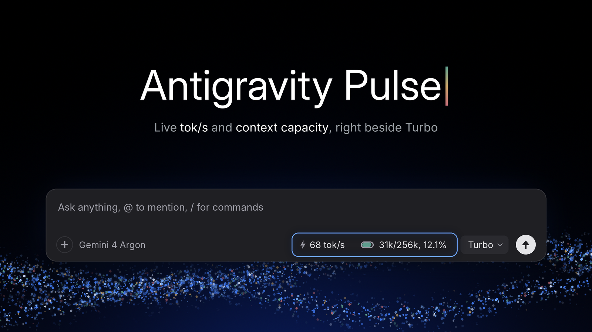
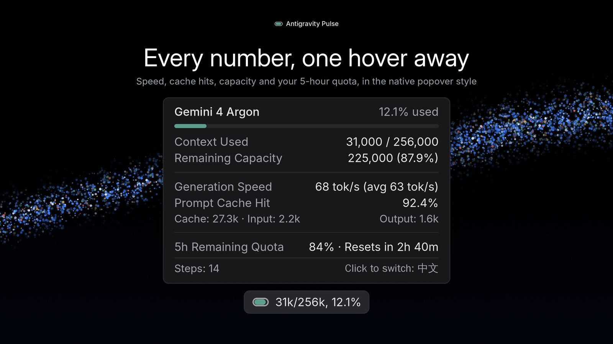
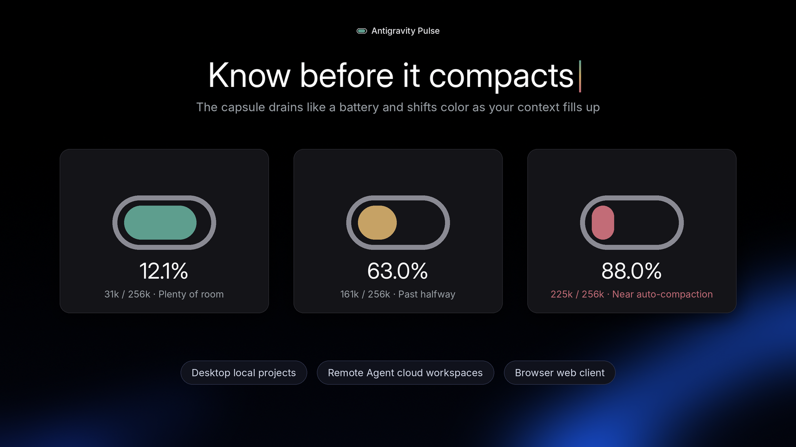

<p align="center">
  
</p>

<h1 align="center">Antigravity Pulse</h1>

<p align="center"><b>Native composer-bar telemetry for Google Antigravity 2.0.</b><br>Live <code>tok/s</code>, a context-capacity capsule, prompt cache hit ratio and the 5-hour quota countdown, right beside <code>Turbo</code>.</p>

<p align="center">
  <a href="https://github.com/akelabs/antigravity-pulse/releases/latest"></a>
  
  
  
</p>

<p align="center"><a href="#quick-start"><b>Quick Start</b></a> · <a href="#why-antigravity-pulse"><b>Features</b></a> · <a href="#privacy--security"><b>Privacy</b></a> · <a href="https://github.com/akelabs/antigravity-pulse/releases/latest"><b>Download</b></a><br><sub><a href="README.md">English</a> · <a href="README.zh-CN.md">简体中文</a></sub></p>

<p align="center">
  
</p>

---

## Why Antigravity Pulse

Existing context monitors sit in the legacy bottom status bar as plain text and fail when switching between multiple chat panes, Remote Agent cloud workspaces, or the browser web client.

**Antigravity Pulse (`AGY-Pulse`)** lives directly inside `.agy-composer-footer` with native typography, spacing, and elevation:

- **Native Composer-Bar Layout**: `⚡ XX tok/s` ➔ `Morandi Runway Capsule (31k/256k, 12.1%)` ➔ `Turbo`.
- **Official `Turbo` Popover Aesthetics**: Zero emojis, inherited UI sans-serif with `tabular-nums`, `500/400` font weights, `6px` radius, Tailwind `shadow-md`, and instant Light/Dark theme adaptation.
- **Per-Pane Isolation**: Reads React Fiber state per composer instance so side-by-side chat panes track their own independent context and model limits (`256k` for Gemini / Claude, `80k` for GPT-OSS, with background shadow/image sub-models filtered out).
- **True End-to-End `tok/s` & Hybrid Delta Estimation**: Measures full output tokens (thinking + response) over real generation wall time, plus character-level live delta estimation between snapshots and `>5,000` token auto-compaction detection (Undo-immune).
- **5-Hour Quota Pool & Reset Countdown**: Accurately decodes Protobuf `Timestamp` objects and shared `gemini` / `premium` 5h quota pools (`Resets in 2h 40m`).
- **3-Habitat Engine**: Works identically across **Desktop Local Projects**, **Desktop Remote Agent (Cloud Workspaces)**, and **Browser Web**.
- **Near-Compaction Warning**: When context usage reaches `>= 85%`, the popover shows a quiet warning that automatic compaction is about to kick in.
- **1-Click `EN` ⇄ `中文` Toggle**: Follows your system language on first run, and a click on the capsule switches popover language anytime (your choice is remembered).

<table>
  <tr>
    <td width="50%" align="center"><br><sub>Every number, one hover away</sub></td>
    <td width="50%" align="center"><br><sub>Know before it compacts</sub></td>
  </tr>
</table>

---

## Quick Start

### 1. Desktop Client (Windows)

**One-line setup (recommended)**: open PowerShell and paste this line. It downloads `setup.ps1`, which checks for [Node.js](https://nodejs.org/) 18+ (and offers to install the LTS version with `winget` if it is missing), fetches the latest `install-context-capsule.js` and `context-capsule-payload.js` into `%USERPROFILE%\.gemini\tools\`, backs up the original `app.asar`, patches `app.asar` atomically in ~20ms, and restarts Antigravity cleanly:

```powershell
$s = "$env:TEMP\agy-pulse-setup.ps1"; Invoke-WebRequest "https://github.com/akelabs/antigravity-pulse/releases/latest/download/setup.ps1" -OutFile $s -UseBasicParsing; powershell -NoProfile -ExecutionPolicy Bypass -File "$s"; Remove-Item $s -ErrorAction SilentlyContinue
```

> Antigravity restarts automatically during setup (append `-Confirm` if you prefer an interactive prompt before closing it), so save your work first. If you are connected through remote desktop, the connection will drop only if you run inside an Antigravity terminal.

Prefer clicking or offline install? Download `setup.ps1`, `setup.cmd`, `install-context-capsule.js`, and `context-capsule-payload.js` from **[Releases](../../releases)** into one folder and double-click `setup.cmd` (it automatically detects the local `.js` files and installs offline without re-downloading).

Check status in `< 5ms` (useful after silent Antigravity client updates — re-run the install command anytime an official update overwrites `app.asar`):

```powershell
$s = "$env:TEMP\agy-pulse-setup.ps1"; Invoke-WebRequest "https://github.com/akelabs/antigravity-pulse/releases/latest/download/setup.ps1" -OutFile $s -UseBasicParsing; powershell -NoProfile -ExecutionPolicy Bypass -File "$s" -Action check; Remove-Item $s -ErrorAction SilentlyContinue
```

<details>
<summary>Manual setup (if you'd rather not run the script)</summary>

1. Install [Node.js](https://nodejs.org/) LTS (18 or newer), or run `winget install OpenJS.NodeJS.LTS`. Open a new PowerShell window and check with `node --version`.
2. Create `%USERPROFILE%\.gemini\tools\` and put `install-context-capsule.js` and `context-capsule-payload.js` from **[Releases](../../releases)** in it.
3. Run:

```powershell
node "$HOME\.gemini\tools\install-context-capsule.js"            # install or update (add --confirm to prompt before restart)
node "$HOME\.gemini\tools\install-context-capsule.js" --check    # status
```

</details>

### 2. Desktop Client (macOS — Apple Silicon: M1 / M2 / M3 / M4 · ARM64)

**One-line setup (recommended)**: open Terminal and paste this line. If your shell is running under Rosetta 2, it automatically switches back to native `arm64`, prioritizes `/opt/homebrew/bin` for [Node.js](https://nodejs.org/) 18+ (offering to install LTS with Homebrew if missing), downloads `install-context-capsule.js` and `context-capsule-payload.js` into `~/.gemini/tools/`, verifies Apple Silicon architecture compatibility, backs up the original `app.asar` and `Info.plist`, patches `Antigravity.app` atomically in ~20ms, updates `ElectronAsarIntegrity`, clears stale caches, performs local ARM64 ad-hoc re-signing (`codesign`), and restarts Antigravity cleanly:

```bash
s="$(mktemp -t agy-pulse.XXXXXX)" && curl -fsSL https://github.com/akelabs/antigravity-pulse/releases/latest/download/setup.sh -o "$s" && bash "$s" --arch arm64; rm -f "$s"
```

> If `/Applications/Antigravity.app` requires administrator write permission, Terminal will prompt for your macOS login password (`sudo`). Append `--confirm` if you want a confirmation prompt before closing Antigravity. For routine payload updates later, press `Cmd+Shift+P` and run `Developer: Reload Window` to hot-reload in ~1 second without restarting the app.

Check status in `< 5ms` (useful after silent Antigravity client updates):

```bash
s="$(mktemp -t agy-pulse.XXXXXX)" && curl -fsSL https://github.com/akelabs/antigravity-pulse/releases/latest/download/setup.sh -o "$s" && bash "$s" --arch arm64 --check; rm -f "$s"
```

Prefer offline or double-click install? Download `setup.command`, `setup.sh`, `install-context-capsule.js`, and `context-capsule-payload.js` from **[Releases](../../releases)** into one folder. Because browser-downloaded scripts do not carry macOS executable permissions by default, run `chmod +x setup.command setup.sh && xattr -c setup.command setup.sh` once in Terminal to enable double-clicking `setup.command` (or simply run `bash setup.sh --offline --arch arm64` directly in Terminal).

<details>
<summary>Manual setup (if you'd rather not run the script)</summary>

1. Install [Node.js](https://nodejs.org/) LTS (18 or newer), or run `/opt/homebrew/bin/brew install node`. Open a new Terminal window and check with `node --version`.
2. Create `~/.gemini/tools/` and put `install-context-capsule.js` and `context-capsule-payload.js` from **[Releases](../../releases)** in it.
3. Run:

```bash
node ~/.gemini/tools/install-context-capsule.js --arch arm64            # install or update
node ~/.gemini/tools/install-context-capsule.js --arch arm64 --check    # status
```

</details>

### 3. Desktop Client (macOS — Intel x86_64)

**One-line setup (recommended)**: open Terminal and paste this line. It prioritizes `/usr/local/bin` for [Node.js](https://nodejs.org/) 18+ (offering to install LTS with Homebrew if missing), downloads `install-context-capsule.js` and `context-capsule-payload.js` into `~/.gemini/tools/`, verifies Intel architecture compatibility, backs up the original `app.asar` and `Info.plist`, patches `Antigravity.app` atomically in ~20ms, updates `ElectronAsarIntegrity`, clears stale caches, performs local ad-hoc re-signing (`codesign`), and restarts Antigravity cleanly:

```bash
s="$(mktemp -t agy-pulse.XXXXXX)" && curl -fsSL https://github.com/akelabs/antigravity-pulse/releases/latest/download/setup.sh -o "$s" && bash "$s" --arch intel; rm -f "$s"
```

> If `/Applications/Antigravity.app` requires administrator write permission, Terminal will prompt for your macOS login password (`sudo`). Append `--confirm` if you want a confirmation prompt before closing Antigravity. For routine payload updates later, press `Cmd+Shift+P` and run `Developer: Reload Window` to hot-reload in ~1 second without restarting the app.

Check status in `< 5ms` (useful after silent Antigravity client updates):

```bash
s="$(mktemp -t agy-pulse.XXXXXX)" && curl -fsSL https://github.com/akelabs/antigravity-pulse/releases/latest/download/setup.sh -o "$s" && bash "$s" --arch intel --check; rm -f "$s"
```

Prefer offline or double-click install? Download `setup.command`, `setup.sh`, `install-context-capsule.js`, and `context-capsule-payload.js` from **[Releases](../../releases)** into one folder. Run `chmod +x setup.command setup.sh && xattr -c setup.command setup.sh` once in Terminal to enable double-clicking `setup.command`, or run `bash setup.sh --offline --arch intel` directly in Terminal.

<details>
<summary>Manual setup (if you'd rather not run the script)</summary>

1. Install [Node.js](https://nodejs.org/) LTS (18 or newer), or run `/usr/local/bin/brew install node`. Open a new Terminal window and check with `node --version`.
2. Create `~/.gemini/tools/` and put `install-context-capsule.js` and `context-capsule-payload.js` from **[Releases](../../releases)** in it.
3. Run:

```bash
node ~/.gemini/tools/install-context-capsule.js --arch intel            # install or update
node ~/.gemini/tools/install-context-capsule.js --arch intel --check    # status
```

</details>

### 4. Browser Web Client (Chrome / Edge / Tampermonkey)

Every desktop setup run on Windows or macOS also writes the browser version to `~/.gemini/tools/antigravity-pulse-web/` (`%USERPROFILE%\.gemini\tools\antigravity-pulse-web\` on Windows). Only need the web version (including Linux)? Append `-Action web` on Windows, or on macOS / Linux run `bash setup.sh --web` (needs Node.js 18+ and exports to `~/.gemini/tools/antigravity-pulse-web/`).

- **Chrome / Edge Extension (Recommended)**: open `chrome://extensions/` (or `edge://extensions/`), enable **Developer mode**, click **Load unpacked**, and select the `antigravity-pulse-web` folder.
- **Tampermonkey**: Install `antigravity-pulse.user.js` from that folder into Tampermonkey. The userscript runs on Google-hosted Antigravity pages only; for a web client served from `localhost` / `127.0.0.1`, use the extension.

> **Zero Noise Guarantee**: On non-Antigravity pages (Gmail, Google Search, Docs, YouTube, Cloud Console, or unrelated `localhost` apps), the script exits immediately without hooking `fetch` or running background timers.

### 5. Uninstall & Full Recovery

Restore the unpatched `app.asar` (and `Info.plist` on macOS) from `.orig.bak` backup — or strip the hook cleanly if no backup exists — clean up local Pulse files in `~/.gemini/tools/`, and restart Antigravity:

**Windows (PowerShell):**

```powershell
$s = "$env:TEMP\agy-pulse-setup.ps1"; Invoke-WebRequest "https://github.com/akelabs/antigravity-pulse/releases/latest/download/setup.ps1" -OutFile $s -UseBasicParsing; powershell -NoProfile -ExecutionPolicy Bypass -File "$s" -Action uninstall; Remove-Item $s -ErrorAction SilentlyContinue
```

**macOS — Apple Silicon (Terminal):**

```bash
s="$(mktemp -t agy-pulse.XXXXXX)" && curl -fsSL https://github.com/akelabs/antigravity-pulse/releases/latest/download/setup.sh -o "$s" && bash "$s" --arch arm64 --uninstall; rm -f "$s"
```

**macOS — Intel (Terminal):**

```bash
s="$(mktemp -t agy-pulse.XXXXXX)" && curl -fsSL https://github.com/akelabs/antigravity-pulse/releases/latest/download/setup.sh -o "$s" && bash "$s" --arch intel --uninstall; rm -f "$s"
```

Or, with the files already on disk (works completely offline): `node ~/.gemini/tools/install-context-capsule.js --uninstall --clean` (`node "$HOME\.gemini\tools\install-context-capsule.js" --uninstall --clean` in Windows PowerShell; omit `--clean` if you want to keep the `.js` files in `~/.gemini/tools/`).

In the browser, remove the extension from `chrome://extensions/` (or `edge://extensions/`), or delete the script in Tampermonkey.

> **macOS Signature Note**: Because Electron verifies `app.asar` integrity against the app bundle signature on macOS, patching applies a local ad-hoc `codesign` signature. Uninstalling restores the original `app.asar` and `Info.plist` so Antigravity launches normally, but cannot locally recreate Apple's original Developer ID certificate (which may affect built-in auto-updates or macOS TCC permission prompts). To restore the official vendor signature at any time, drag a fresh `Antigravity.app` from the official `.dmg` into `/Applications` — all chats, sign-in state, and settings in `~/Library/Application Support/Antigravity` remain untouched.

---

## Privacy & Security

- **100% Local & Same-Origin**: Reads telemetry strictly from your own active Antigravity session in memory, using pure DOM construction (no `innerHTML` or global Trusted Types overrides). Zero external network requests, zero analytics, zero telemetry servers.
- **Atomic Backup & Surgical `~20ms` Patch**: Automatically saves a clean `.orig.bak` backup before modifying `dist/preload.js` inside `app.asar` via atomic temp-file rename, keeping all other 760+ application files untouched. On macOS, it updates `ElectronAsarIntegrity` in `Contents/Info.plist` locally and invokes the built-in `codesign` tool for local ad-hoc re-signing without uploading any data.

---

## License

Copyright © 2026 Antigravity Pulse Authors. All rights reserved.

Release packages are provided free of charge for personal and individual developer use only. Redistribution, re-hosting, modified re-publishing, or commercial bundling without prior written permission is prohibited.

Antigravity Pulse is an independent community project and is not affiliated with or endorsed by Google.
