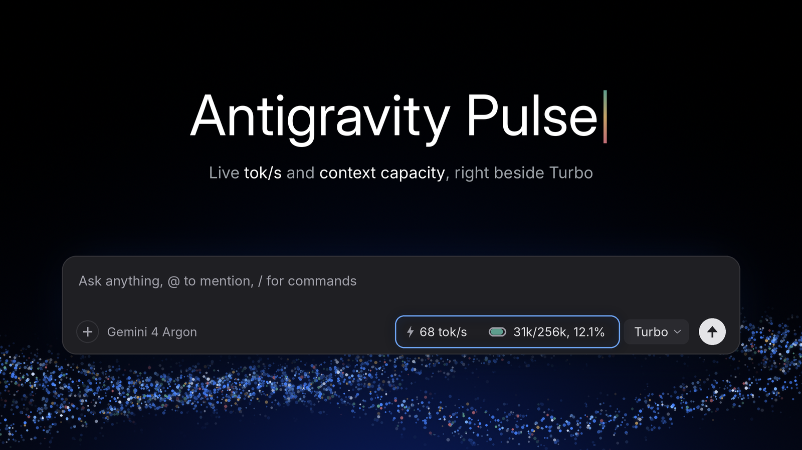
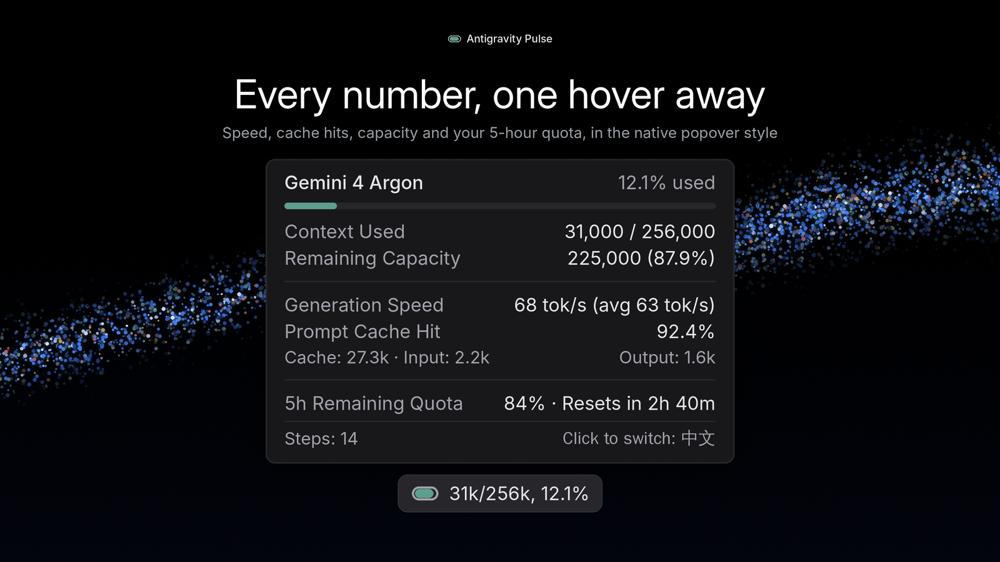
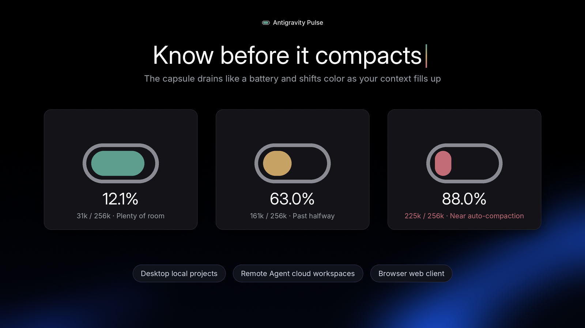

<p align="center">
  
</p>

<h1 align="center">Antigravity 能量胶囊</h1>

<p align="center"><b>专为 Google Antigravity 2.0 打造的纯客户端原生底部栏实时监控。</b><br>在「极速（<code>Turbo</code>）」按钮旁实时显示 <code>tok/s</code>、上下文容量胶囊、Prompt 缓存命中率和 5 小时额度重置倒计时。<br><sub><b>0 外部常驻进程 · 0 本地代理端口 · 0 SQLite 数据库轮询</b></sub></p>

<p align="center">
  <a href="https://github.com/akelabs/antigravity-pulse/releases/latest"></a>
  
  
  
</p>

<p align="center"><a href="#原生架构"><b>原生架构</b></a> · <a href="#核心特性"><b>核心特性</b></a> · <a href="#快速安装"><b>快速安装</b></a> · <a href="#隐私与安全说明"><b>隐私与安全</b></a> · <a href="https://github.com/akelabs/antigravity-pulse/releases/latest"><b>下载</b></a><br><sub><a href="README.md">English</a> · <a href="README.zh-CN.md">简体中文</a></sub></p>

<p align="center">
  
</p>

---

<a id="原生架构"></a>

## 为什么采用纯客户端原生架构？（零后台常驻）

其他上下文监控工具往往需要在系统后台额外常驻独立的 Node.js / Python 守护进程、开启本地轮询服务端口，或高频扫描磁盘上的本地 SQLite 数据库文件（`state.vscdb` 与本地日志）才能推算上下文上限与用量——不仅安装链路重、额外占用后台内存与磁盘 I/O，还容易在同屏多窗口、远程云端会话或客户端升级后失联。

**Antigravity 能量胶囊（`Antigravity Pulse`）** 采用截然不同的**纯客户端原生实现**：**0 外部常驻进程、0 本地代理端口、0 SQLite 数据库轮询**。直接运行在 Antigravity 原生渲染层内部，同源直连客户端内存级 `GeneratorMetadata` 与轨迹状态（辅以 React Fiber 组件树隔离与无损流感知），装完即与官方底部栏融为一体：

| 对比维度 | 传统外挂后台常驻 / 扫库方案 | Antigravity 能量胶囊（纯客户端原生） |
| :--- | :--- | :--- |
| **后台常驻开销** | 需额外常驻 Node.js / Python 守护进程与本地轮询端口 | **0 外部常驻进程 · 0 本地端口**（直接运行于原生渲染层内部） |
| **数据获取方式** | 高频扫描本地 `state.vscdb` SQLite 数据库与磁盘日志 | **同源直读内存级 `GeneratorMetadata` 与会话状态**（0 磁盘 I/O，空闲 0 请求） |
| **模型识别与动态上限** | 依赖手工写死模型白名单或滞后日志推算 | **零硬编码动态识别新模型与真实压缩水位**（`80k` / `256k` / `512k` / `840k` / `1M+`）＋按模型自学习记忆 |
| **多窗口、Swarm 与云端** | 同屏多开或子智能体易串台，云端／网页版易失联 | **组件级＋子 AI / Swarm 独立隔离**，桌面本地、云端与网页版三栖通吃 |
| **界面融合质感** | 挤在旧式最底部状态栏显示纯文字 | **原生嵌入 `.agy-composer-footer` 工具栏**，紧邻官方 `Turbo` 按钮 |
| **热更新与无损恢复** | 需维护后台服务启停，客户端升级后易断连残留 | **`Reload Window` 1 秒热生效**，`< 5ms` 极速巡检，`.orig.bak` 一行无损还原 |

1. **零硬编码动态模型识别、实时上限与自动学习记忆**：无需后台扫库，直接从原生 `GeneratorMetadata` 与实时 `GetUserStatus` 模型清单（含 `groupedModels`）读取官方显示名称与服务端真实压缩水位，未来上线的任意新模型（含 Gemini 4 Neon、Carbon、Hydrogen 等）均可自动识别，无需手动更新白名单；本地会话会自动按模型记住实测真实上限（`512k`／`840k`／`1M+`），让新开 0 步空对话也能直接显示准确上限；暂未下发元数据的云端／网页会话初始匹配 `256k`，突破旧水位未压缩时**自动破壁解锁并跨会话记忆 `512k`／`1M`**，同时过滤影子模型，**空闲时 0 重复请求**。
2. **多窗口、Swarm 子 AI 与本地 / 云端 / 网页三栖精准隔离**：每个聊天框从自身 React Fiber 组件树独立锁定会话 ID，且 **Swarm / 子智能体会话严格锁定其实际执行的模型、上下文上限与 5 小时配额池**，绝不被主界面底部输入框的全局模型选择器覆盖；一套内核同时支持 **Windows、macOS（Apple Silicon & Intel）桌面客户端**、**Remote Agent 云端项目**及**浏览器网页版**。
3. **官方同级克制美学与纯原生 DOM 安全渲染**：继承官方底部栏无衬线字体、`tabular-nums` 等宽数字、`6px` 圆角与明暗自适应 `shadow-md` 阴影，搭配 3A 冷雾莫兰迪三色胶囊；全程**零 `innerHTML`** 纯原生 DOM 构建，严格符合 CSP 与 Trusted Types 安全规范。
4. **1 秒热重载与 `< 5ms` 自愈**：首次注入（约 `20ms` 原子修补）自动留存 `.orig.bak` 原包备份；日常更新载荷执行 `Developer: Reload Window` 即可 **1 秒免重启生效**，支持 `< 5ms` 状态自检与一行命令随时无损还原。

---

## 核心特性

- **原生底部栏融合排布**：从左到右依次为 `⚡ XX tok/s` ➔ `3A 莫兰迪跑道胶囊 (31k/256k, 12.1%)` ➔ `极速 (Turbo)`，无需低头去旧式状态栏找小字。
- **1:1 对齐官方 `Turbo` 浮层质感**：全面剔除花哨 Emoji，标题 `500`／正文 `400` 字重与等宽数字对齐，实时自适应白天与黑夜模式。
- **真实端到端 `tok/s` 与上下文压缩追踪**：完整统计输出 Tokens（含思考链与正文）除以真实生成耗时，结合快照间字符级流式增量估算；内置双阈值上下文压缩检测（释放 `> 5,000` Tokens 且 `>= 25%`，自动过滤思考链剥离与临时上下文微幅回落，兼容自动压缩与手动 `/compact`，支持撤回消息 Undo 免疫且随新轮次增长自动退场，绝不遮挡后续 `>= 85%` 临界归档提醒）。
- **精准 5 小时额度倒计时**：完整解析 Protobuf `Timestamp` 与共享配额池重置时间（如 `2h 40m 后重置`），严格隔离跨池额度。
- **点击胶囊秒切中英双语**：首次使用自动跟随系统语言；之后轻点胶囊即可在 `中文` 与 `English` 间即时切换并记住选择，内置防回译标记，与客户端汉化环境完美兼容。

<table>
  <tr>
    <td width="50%" align="center"><br><sub>悬停即看全部指标</sub></td>
    <td width="50%" align="center"><br><sub>胶囊随容量变色，压缩前心里有数</sub></td>
  </tr>
</table>

---

## 快速安装

### 1. Windows 桌面客户端

**一句命令配置（推荐）**：打开 PowerShell，粘贴下面这一行运行。它会下载 `setup.ps1`：先检查电脑上有没有 [Node.js](https://nodejs.org/) 18 以上版本（没有就询问后用 `winget` 装 LTS 版），再把最新的 `install-context-capsule.js` 和 `context-capsule-payload.js` 下载到 `%USERPROFILE%\.gemini\tools\`，自动备份原始 `app.asar` 后约 20ms 完成原子级无损注入，并自动平滑重启客户端：

```powershell
$s = "$env:TEMP\agy-pulse-setup.ps1"; Invoke-WebRequest "https://github.com/akelabs/antigravity-pulse/releases/latest/download/setup.ps1" -OutFile $s -UseBasicParsing; powershell -NoProfile -ExecutionPolicy Bypass -File "$s"; Remove-Item $s -ErrorAction SilentlyContinue
```

> 配置过程中客户端会自动重启（若希望关闭客户端前先手动确认，可在末尾追加 `-Confirm`），请先保存手头工作；若在 Antigravity 内置终端并处于远程桌面环境下运行，重启时连接可能短暂断开。

**双击 / 离线方式**：从 **[Releases](../../releases)** 下载 `setup.ps1`、`setup.cmd`、`install-context-capsule.js`、`context-capsule-payload.js` 放进同一个文件夹，双击 `setup.cmd` 即可自动识别同目录本地文件完成离线安装（无需联网重下）。

客户端静默更新覆盖 `app.asar` 后重新运行一次安装命令即可恢复；平时可在 `< 5ms` 内巡检状态：

```powershell
$s = "$env:TEMP\agy-pulse-setup.ps1"; Invoke-WebRequest "https://github.com/akelabs/antigravity-pulse/releases/latest/download/setup.ps1" -OutFile $s -UseBasicParsing; powershell -NoProfile -ExecutionPolicy Bypass -File "$s" -Action check; Remove-Item $s -ErrorAction SilentlyContinue
```

<details>
<summary>手动配置环境（不想运行脚本时）</summary>

1. 安装 [Node.js](https://nodejs.org/) LTS（18 以上），或运行 `winget install OpenJS.NodeJS.LTS`；新开一个 PowerShell 窗口，用 `node --version` 确认装好。
2. 新建 `%USERPROFILE%\.gemini\tools\` 文件夹，把 **[Releases](../../releases)** 里的 `install-context-capsule.js` 和 `context-capsule-payload.js` 放进去。
3. 运行：

```powershell
node "$HOME\.gemini\tools\install-context-capsule.js"            # 安装或更新（加 --confirm 可重启前确认）
node "$HOME\.gemini\tools\install-context-capsule.js" --check    # 查看状态
```

</details>

### 2. macOS 桌面客户端 — Apple Silicon 版（M1 / M2 / M3 / M4 · ARM64）

**一句命令配置（推荐）**：打开 Terminal（终端），粘贴下面这一行运行。若当前终端处于 Rosetta 2 转译环境会自动切回原生 `arm64`，优先从 `/opt/homebrew/bin` 检测 [Node.js](https://nodejs.org/) 18 以上版本（缺省时可询问通过 Homebrew 安装）、下载两个 `.js` 文件至 `~/.gemini/tools/`、校验 Apple Silicon 芯片架构兼容性、自动备份原始 `app.asar` 与 `Info.plist`、约 20ms 原子修补 `Antigravity.app`、同步更新 `ElectronAsarIntegrity` 校验值、清理旧缓存并执行原生 ARM64 `codesign` ad-hoc 重签名与客户端平滑重启：

```bash
s="$(mktemp -t agy-pulse.XXXXXX)" && curl -fsSL https://github.com/akelabs/antigravity-pulse/releases/latest/download/setup.sh -o "$s" && bash "$s" --arch arm64; rm -f "$s"
```

> 若 `/Applications/Antigravity.app` 需要管理员写权限，终端会提示输入开机密码（`sudo`）；追加 `--confirm` 可在关闭客户端前交互确认。日常更新载荷只需按 `Cmd+Shift+P` -> `Developer: Reload Window` 即可 1 秒免重启热生效。

客户端自动更新后，可在 `< 5ms` 内巡检状态：

```bash
s="$(mktemp -t agy-pulse.XXXXXX)" && curl -fsSL https://github.com/akelabs/antigravity-pulse/releases/latest/download/setup.sh -o "$s" && bash "$s" --arch arm64 --check; rm -f "$s"
```

**双击 / 离线方式**：从 **[Releases](../../releases)** 下载 `setup.command`、`setup.sh`、`install-context-capsule.js`、`context-capsule-payload.js` 放同一目录。由于浏览器直接下载的脚本默认不带 macOS 可执行权限，首次在终端执行一次 `chmod +x setup.command setup.sh && xattr -c setup.command setup.sh` 后即可直接双击 `setup.command` 自动离线安装，或直接在终端运行 `bash setup.sh --offline --arch arm64`。

<details>
<summary>手动配置环境（不想运行脚本时）</summary>

1. 安装 [Node.js](https://nodejs.org/) LTS（18 以上），或运行 `/opt/homebrew/bin/brew install node`；新开一个终端窗口，用 `node --version` 确认装好。
2. 新建 `~/.gemini/tools/` 文件夹，把 **[Releases](../../releases)** 里的 `install-context-capsule.js` 和 `context-capsule-payload.js` 放进去。
3. 运行：

```bash
node ~/.gemini/tools/install-context-capsule.js --arch arm64            # 安装或更新
node ~/.gemini/tools/install-context-capsule.js --arch arm64 --check    # 查看状态
```

</details>

### 3. macOS 桌面客户端 — Intel 芯片版（x86_64）

**一句命令配置（推荐）**：打开 Terminal（终端），粘贴下面这一行运行。优先从 `/usr/local/bin` 检测 [Node.js](https://nodejs.org/) 18 以上版本（缺省时可询问通过 Homebrew 安装）、下载两个 `.js` 文件至 `~/.gemini/tools/`、校验 Intel 架构兼容性、自动备份原始 `app.asar` 与 `Info.plist`、约 20ms 原子修补 `Antigravity.app`、同步更新 `ElectronAsarIntegrity` 校验值、清理旧缓存并完成本地 ad-hoc 重签名（`codesign`）与客户端平滑重启：

```bash
s="$(mktemp -t agy-pulse.XXXXXX)" && curl -fsSL https://github.com/akelabs/antigravity-pulse/releases/latest/download/setup.sh -o "$s" && bash "$s" --arch intel; rm -f "$s"
```

> 若 `/Applications/Antigravity.app` 需要管理员写权限，终端会提示输入开机密码（`sudo`）；追加 `--confirm` 可在关闭客户端前交互确认。日常更新载荷只需按 `Cmd+Shift+P` -> `Developer: Reload Window` 即可 1 秒免重启热生效。

客户端自动更新后，可在 `< 5ms` 内巡检状态：

```bash
s="$(mktemp -t agy-pulse.XXXXXX)" && curl -fsSL https://github.com/akelabs/antigravity-pulse/releases/latest/download/setup.sh -o "$s" && bash "$s" --arch intel --check; rm -f "$s"
```

**双击 / 离线方式**：从 **[Releases](../../releases)** 下载 `setup.command`、`setup.sh`、`install-context-capsule.js`、`context-capsule-payload.js` 放同一目录。首次在终端执行一次 `chmod +x setup.command setup.sh && xattr -c setup.command setup.sh` 后即可双击 `setup.command`，或直接在终端运行 `bash setup.sh --offline --arch intel`。

<details>
<summary>手动配置环境（不想运行脚本时）</summary>

1. 安装 [Node.js](https://nodejs.org/) LTS（18 以上），或运行 `/usr/local/bin/brew install node`；新开一个终端窗口，用 `node --version` 确认装好。
2. 新建 `~/.gemini/tools/` 文件夹，把 **[Releases](../../releases)** 里的 `install-context-capsule.js` 和 `context-capsule-payload.js` 放进去。
3. 运行：

```bash
node ~/.gemini/tools/install-context-capsule.js --arch intel            # 安装或更新
node ~/.gemini/tools/install-context-capsule.js --arch intel --check    # 查看状态
```

</details>

### 4. 浏览器网页版（Chrome / Edge / 油猴）

Windows 与 macOS 桌面安装时均会自动导出至 `~/.gemini/tools/antigravity-pulse-web/`（Windows 下为 `%USERPROFILE%\.gemini\tools\antigravity-pulse-web\`）。只要网页版（含 Linux）：Windows 在命令末尾加 `-Action web`；macOS / Linux 运行 `bash setup.sh --web`（需要 Node.js 18 以上，导出到 `~/.gemini/tools/antigravity-pulse-web/`）。

- **Chrome / Edge 扩展（推荐）**：打开 `chrome://extensions/`（或 `edge://extensions/`），开启右上角**开发者模式**，点击**加载已解压的扩展程序**，选择 `antigravity-pulse-web` 文件夹即可。
- **Tampermonkey 油猴脚本**：在油猴面板导入该文件夹里的 `antigravity-pulse.user.js`。油猴脚本只在 Google 托管的 Antigravity 网页上运行；从 `localhost` / `127.0.0.1` 打开的网页端请用扩展。

> **零干扰守卫**：在 Gmail、Google 搜索、Docs、YouTube、Cloud Console 或普通本地开发网页中会自动静默退出，不挂载 `fetch` 钩子、不跑后台轮询。

### 5. 卸载与完整恢复

一键从 `.orig.bak` 原始备份还原 `app.asar`（及 macOS `Info.plist`；若无备份则精确剥离 `preload.js` 钩子），同步清理 `~/.gemini/tools/` 下的本地能量胶囊文件，并重启客户端：

**Windows (PowerShell)：**

```powershell
$s = "$env:TEMP\agy-pulse-setup.ps1"; Invoke-WebRequest "https://github.com/akelabs/antigravity-pulse/releases/latest/download/setup.ps1" -OutFile $s -UseBasicParsing; powershell -NoProfile -ExecutionPolicy Bypass -File "$s" -Action uninstall; Remove-Item $s -ErrorAction SilentlyContinue
```

**macOS — Apple Silicon 版（Terminal）：**

```bash
s="$(mktemp -t agy-pulse.XXXXXX)" && curl -fsSL https://github.com/akelabs/antigravity-pulse/releases/latest/download/setup.sh -o "$s" && bash "$s" --arch arm64 --uninstall; rm -f "$s"
```

**macOS — Intel 芯片版（Terminal）：**

```bash
s="$(mktemp -t agy-pulse.XXXXXX)" && curl -fsSL https://github.com/akelabs/antigravity-pulse/releases/latest/download/setup.sh -o "$s" && bash "$s" --arch intel --uninstall; rm -f "$s"
```

文件已在本机时（完全离线可用），也可直接运行：`node ~/.gemini/tools/install-context-capsule.js --uninstall --clean`（Windows PowerShell 下运行 `node "$HOME\.gemini\tools\install-context-capsule.js" --uninstall --clean`；若想保留 `~/.gemini/tools/` 下的 `.js` 脚本可省略 `--clean`）。

浏览器端在 `chrome://extensions/`（或 `edge://extensions/`）里移除扩展，或在油猴面板删除脚本即可。

> **macOS 签名与恢复说明**：由于 macOS 版 Electron 会校验 `app.asar` 与应用包签名，安装时会在备份原始文件后执行本地 `codesign` ad-hoc 重签名。`--uninstall` 会还原原始 `app.asar` 与 `Info.plist` 确保客户端正常启动，但本地无法凭空重新签发苹果官方 Developer ID 证书（这可能影响内置自动更新器或部分 macOS 系统权限记忆）。如需随时 100% 恢复官方原厂签名，重新从官方 `.dmg` 将 `Antigravity.app` 拖入 `/Applications` 覆盖即可——`~/Library/Application Support/Antigravity` 中的全部对话、登录态与个人配置均完好无损。

---

## 隐私与安全说明

- **零外部联网、零后台常驻与纯 DOM 渲染**：所有指标均在本地渲染进程同源读取当前会话内存状态，不启动任何外部守护进程或本地端口；浮层采用纯 DOM API 构建（不使用 `innerHTML`，不覆盖宿主页面全局 Trusted Types 策略），绝不向任何第三方服务器发送请求。
- **原子备份与 20ms 极速补丁**：修改前自动保存干净的 `.orig.bak` 原始备份，通过临时文件原子重命名更新 `app.asar` 内的 `dist/preload.js`，包内其余 760+ 个官方文件与已有汉化保持 `0` 改动。macOS 下仅在本地同步更新 `Contents/Info.plist` 中的 `ElectronAsarIntegrity` 并调用系统自带 `codesign` 进行本地 ad-hoc 重签名，不上传任何数据。

---

## 许可说明

Copyright © 2026 Antigravity Pulse Authors. 保留所有权利（All rights reserved）。

本项目发布包免费供个人与独立开发者日常使用；未经书面许可，禁止二次分发、修改后重新发布或用于商业捆绑。

Antigravity 能量胶囊是独立的社区项目，与 Google 没有关联，也未获 Google 认可。
