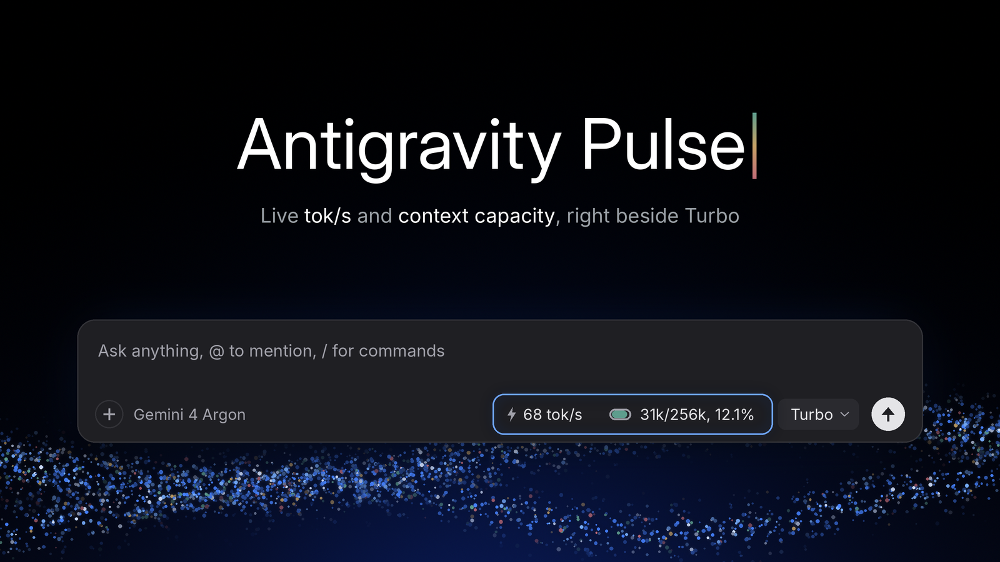
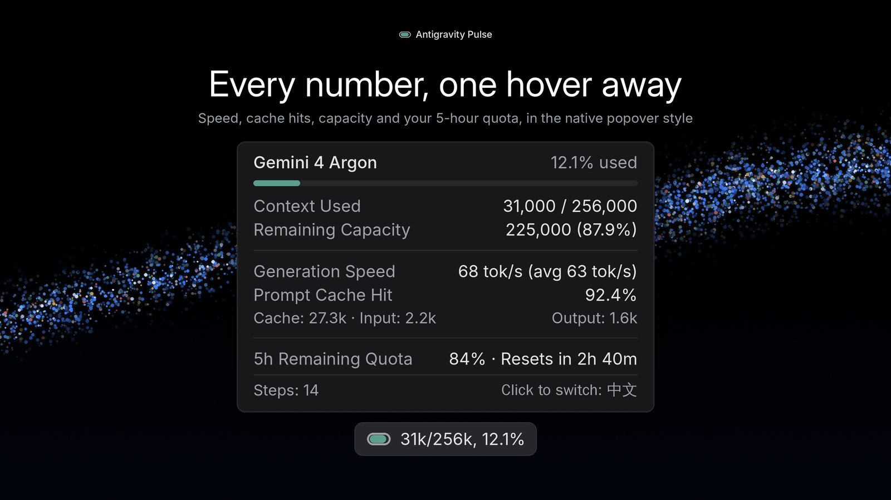
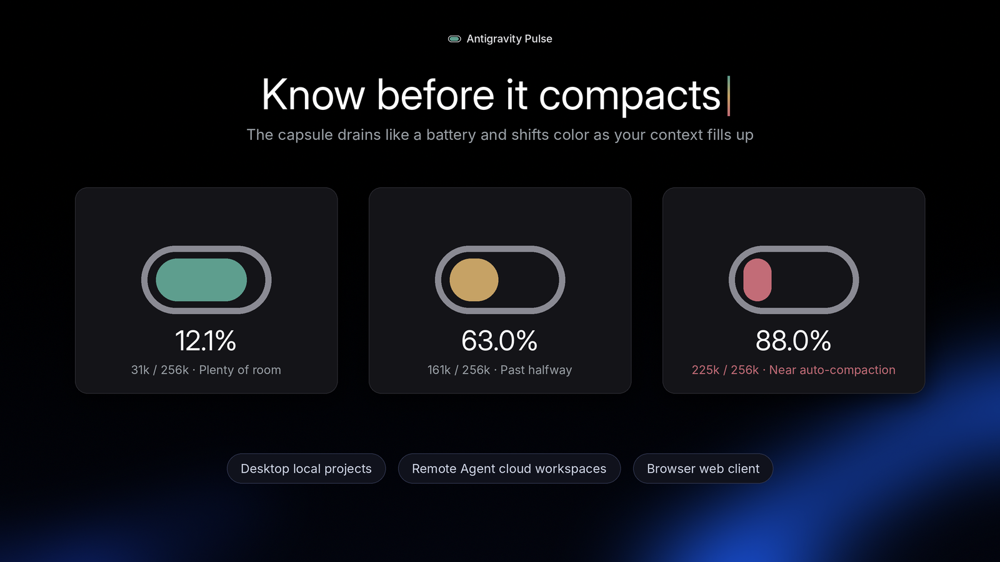

<p align="center">
  
</p>

<h1 align="center">Antigravity 能量胶囊</h1>

<p align="center"><b>专为 Google Antigravity 2.0 打造的原生底部栏实时监控。</b><br>在「极速（<code>Turbo</code>）」按钮旁实时显示 <code>tok/s</code>、上下文容量胶囊、Prompt 缓存命中率和 5 小时额度重置倒计时。</p>

<p align="center">
  <a href="https://github.com/akelabs/antigravity-pulse/releases/latest"></a>
  
  
  
</p>

<p align="center"><a href="#快速安装"><b>快速安装</b></a> · <a href="#核心特性"><b>核心特性</b></a> · <a href="#隐私与安全说明"><b>隐私与安全</b></a> · <a href="https://github.com/akelabs/antigravity-pulse/releases/latest"><b>下载</b></a><br><sub><a href="README.md">English</a> · <a href="README.zh-CN.md">简体中文</a></sub></p>

<p align="center">
  
</p>

---

## 核心特性

- **原生底部栏融合排布**：从左到右依次为 `⚡ XX tok/s` ➔ `3A 莫兰迪跑道胶囊 (31k/256k, 12.1%)` ➔ `极速 (Turbo)`，无需低头去旧式状态栏找小字。
- **1:1 对齐官方 `Turbo` 浮层质感**：全面剔除花哨 Emoji，继承官方 UI 无衬线字体与 `tabular-nums` 等宽数字，标题 `500`／正文 `400` 字重、`6px` 圆角、官方 Tailwind `shadow-md` 阴影，实时自适应白天与黑夜模式。
- **三栖全场景打通**：同时支持 **桌面客户端本地项目**、**桌面客户端云端项目（Remote Agent）** 与 **浏览器网页版**。
- **多对话框精准隔离与动态分母**：通过 React Fiber 隔离同窗口多聊天面板；自动识别 `256k`（Gemini / Claude）与 `80k`（GPT-OSS）压缩上限，自动过滤后台子智能体与生图影子模型。
- **精准 5 小时额度倒计时与压缩感知**：完整解析 Protobuf `Timestamp` 与共享配额池重置时间（如 `2h 40m 后重置`），内置 `> 5,000` Tokens 自动压缩检测（支持撤回消息 Undo 免疫）及 `>= 85%` 临界归档提醒。
- **点击胶囊秒切中英双语**：首次使用自动跟随系统语言；之后轻点胶囊即可在 `中文` 与 `English` 间即时切换并记住选择，内置防回译标记，与客户端汉化环境完美兼容。

<table>
  <tr>
    <td width="50%" align="center"><br><sub>悬停即看全部指标</sub></td>
    <td width="50%" align="center"><br><sub>胶囊随容量变色，压缩前心里有数</sub></td>
  </tr>
</table>

---

## 快速安装

### 1. Windows 桌面客户端

**一句命令配置（推荐）**：打开 PowerShell，粘贴下面这一行运行。它会下载 `setup.ps1`：先检查电脑上有没有 [Node.js](https://nodejs.org/) 18 以上版本（没有就询问后用 `winget` 装 LTS 版），再把最新的 `install-context-capsule.js` 和 `context-capsule-payload.js` 下载到 `%USERPROFILE%\.gemini\tools\`，约 20ms 完成内存级无损注入，并自动平滑重启客户端：

```powershell
$s = "$env:TEMP\agy-pulse-setup.ps1"; Invoke-WebRequest "https://github.com/akelabs/antigravity-pulse/releases/latest/download/setup.ps1" -OutFile $s -UseBasicParsing; powershell -NoProfile -ExecutionPolicy Bypass -File $s
```

> 配置过程中客户端会自动重启，请先保存手头工作；如果正在用远程桌面连接，连接会断开。

**想双击运行**：从 **[Releases](../../releases)** 下载 `setup.ps1`、`setup.cmd`、`install-context-capsule.js`、`context-capsule-payload.js` 放进同一个文件夹，双击 `setup.cmd` 即可（给 `setup.ps1` 加 `-Offline` 就直接用这几个本地文件，不再联网下载）。

客户端自动更新后，可在 `< 5ms` 内巡检状态，同一行命令末尾加 `-Action check`：

```powershell
$s = "$env:TEMP\agy-pulse-setup.ps1"; Invoke-WebRequest "https://github.com/akelabs/antigravity-pulse/releases/latest/download/setup.ps1" -OutFile $s -UseBasicParsing; powershell -NoProfile -ExecutionPolicy Bypass -File $s -Action check
```

<details>
<summary>手动配置环境（不想运行脚本时）</summary>

1. 安装 [Node.js](https://nodejs.org/) LTS（18 以上），或运行 `winget install OpenJS.NodeJS.LTS`；新开一个 PowerShell 窗口，用 `node --version` 确认装好。
2. 新建 `%USERPROFILE%\.gemini\tools\` 文件夹，把 **[Releases](../../releases)** 里的 `install-context-capsule.js` 和 `context-capsule-payload.js` 放进去。
3. 运行：

```powershell
node "$HOME\.gemini\tools\install-context-capsule.js"            # 安装或更新
node "$HOME\.gemini\tools\install-context-capsule.js" --check    # 查看状态
```

</details>

### 2. 浏览器网页版（Chrome / Edge / 油猴）

每次在 Windows 上配置时，都会顺带把网页版生成到 `%USERPROFILE%\.gemini\tools\antigravity-pulse-web\`。只要网页版：Windows 上把上面那行命令末尾加 `-Action web`；macOS / Linux 从 **[Releases](../../releases)** 下载 `setup.sh` 后运行 `bash setup.sh`（需要 Node.js 18 以上，生成到 `~/.gemini/tools/antigravity-pulse-web/`）。

- **Chrome / Edge 扩展（推荐）**：打开 `chrome://extensions/`（或 `edge://extensions/`），开启右上角**开发者模式**，点击**加载已解压的扩展程序**，选择 `antigravity-pulse-web` 文件夹即可。
- **Tampermonkey 油猴脚本**：在油猴面板导入该文件夹里的 `antigravity-pulse.user.js`。油猴脚本只在 Google 托管的 Antigravity 网页上运行；从 `localhost` / `127.0.0.1` 打开的网页端请用扩展。

> **零干扰守卫**：在 Gmail、Google 搜索、Docs、YouTube 或普通本地开发网页中会自动静默退出，不挂载 `fetch` 钩子、不跑后台轮询。

### 3. 卸载

一键剥离钩子，还原原始 `preload.js`（客户端会重启）：

```powershell
$s = "$env:TEMP\agy-pulse-setup.ps1"; Invoke-WebRequest "https://github.com/akelabs/antigravity-pulse/releases/latest/download/setup.ps1" -OutFile $s -UseBasicParsing; powershell -NoProfile -ExecutionPolicy Bypass -File $s -Action uninstall
```

文件已在本机时，也可以直接运行：`node "$HOME\.gemini\tools\install-context-capsule.js" --uninstall`。

浏览器端在 `chrome://extensions/`（或 `edge://extensions/`）里移除扩展，或在油猴面板删除脚本即可。

---

## 隐私与安全说明

- **零外部联网**：所有指标均在本地渲染进程同源读取当前会话内存状态，绝不向任何第三方服务器发送请求。
- **无损极速补丁**：仅在内存中精确更新 `app.asar` 内的 `dist/preload.js`，包内其余 760+ 个官方文件与已有汉化保持 `0` 改动。

---

## 许可说明

Copyright © 2026 Antigravity Pulse Authors. 发布包免费供个人与开发者日常使用。

Antigravity 能量胶囊是独立的社区项目，与 Google 没有关联，也未获 Google 认可。
